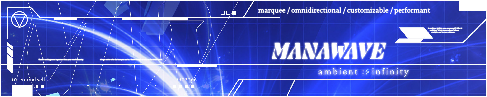

# MANAWAVE



MANAWAVE is a zero-dependency, customizable, and omnidirectional marquee library for vanilla javascript.

Artistically, it's the website [manawave.art](https://manawave.art) that uses the MANAWAVE library. The website contains a lot of artistic and visual experimentation by [ryuuart](https://github.com/ryuuart).

## Getting Started

### Documentation

You can take a deep dive into using MANAWAVE on the [documentation site](https://manawave.art/docs/quickstart).

### Installation

You can install in two ways: using a CDN script or using `npm`.

#### CDN

Include this in the `<head>` portion of your HTML.

```html
<script defer src="https://cdn.jsdelivr.net/npm/manawave/dist/manawave.min.js"></script>
```

#### npm

You can use `pnpm`, `yarn`, or the others instead of `npm` if you want.

```sh
npm install manawave
```

### Basic Example

```html
<manawave-marquee speed="1.5" direction="35.5" autoplay>
  Content&nbsp;
</manawave-marquee>
```

## Developing

This repo is a [pnpm workspace](https://pnpm.io/workspaces) with two packages:

- [manawave](./package/) — the library itself
- [manawave-demo](./web/) — manawave.art, the demo site and docs

[mise](https://mise.jdx.dev) pins the toolchain (Node and pnpm) and runs every task. Install it, then:

```sh
mise trust
mise run test
```

The first run installs Node, pnpm, and the workspace dependencies for you.

| Task                | What it does                                            |
| ------------------- | ------------------------------------------------------- |
| `mise run build`    | Build the library into `package/dist`                   |
| `mise run dev`      | Serve the library's example playground with hot reload  |
| `mise run test`     | Run the browser unit tests across every browser         |
| `mise run lint`     | Typecheck every package                                 |
| `mise run site`     | Serve manawave.art locally                              |
| `mise run changeset`| Record a changeset describing the next release          |

Every third-party version lives in the [`catalog`](./pnpm-workspace.yaml) so the whole
repo moves together; the individual `package.json` files just say `catalog:`.

The library builds on Vite and ships as a single drop-in file. The site is Astro, with
the docs on Starlight and the art pages styled with Tailwind — see the
[site README](./web/README.md#styling) for how the two are kept apart.

### Testing

The unit tests are real browser tests — they run inside Chrome and Firefox against a real
layout engine via [Vitest browser mode](https://vitest.dev/guide/browser/) with
[WebdriverIO](https://webdriver.io) driving. There is no jsdom.

You need Chrome and Firefox installed; WebdriverIO downloads the matching drivers itself.

Safari is opt-in because it has no headless mode and needs a one-time setup:

```sh
safaridriver --enable
MANAWAVE_SAFARI=1 mise run test
```

## Contributing

MANAWAVE started as a solo hobby project so there's definitely something that could be improved. Don't be afraid to [create issues](https://github.com/ryuuart/manawave/issues/new) or PRs for the project. It's greatly appreciated!!

## License

[MIT License](./LICENSE) for everything!
